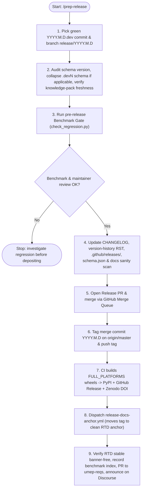

# SUEWS Release Manual

> **Canonical Rules Notice**
>
> Active release rules, sanity checks, and operational skills supersede this manual whenever prose drifts. Always read and execute via:
> - Rules: [`.claude/rules/docs/release-docs-sanity.md`](../.claude/rules/docs/release-docs-sanity.md), [`.claude/rules/python/schema-versioning.md`](../.claude/rules/python/schema-versioning.md), [`.claude/rules/changelog/format.md`](../.claude/rules/changelog/format.md), [`.claude/rules/physics-change-evidence.md`](../.claude/rules/physics-change-evidence.md), and [`.claude/rules/autonomous-workflow.md`](../.claude/rules/autonomous-workflow.md)
> - Skills: `/prep-release` ([`.claude/skills/prep-release/SKILL.md`](../.claude/skills/prep-release/SKILL.md)), `/republish-docs` ([`.claude/skills/republish-docs/SKILL.md`](../.claude/skills/republish-docs/SKILL.md)), `/log-changes` ([`.claude/skills/log-changes/SKILL.md`](../.claude/skills/log-changes/SKILL.md)), and `/queue-pr` ([`.claude/skills/queue-pr/SKILL.md`](../.claude/skills/queue-pr/SKILL.md))

## Executive Summary

SUEWS uses a **CalVer rolling release model** (`YYYY.M.D`) that supports continuous research-software development while providing reproducible, citable releases:
- **Release when ready**, not on a fixed calendar.
- **Nightly and `.dev` builds (`YYYY.M.D.dev`)** publish pre-release wheels to **TestPyPI** (`deploy_testpypi`).
- **Formal tagged releases (`YYYY.M.D`)** publish production `cp312-abi3` wheels to **PyPI** (`deploy_pypi`), create a GitHub Release, and mint a **Zenodo DOI**.
- **Single wheel per platform**: One `cp312-abi3` wheel per `(OS, arch)` installs on CPython 3.12+ and NumPy 1.22+ (covering QGIS 3 LTR, QGIS 4, and standalone Python; the pre-2026-04 `rc1` NumPy-1.x dual-tag variant is retired).
- **Clean release documentation**: `.github/workflows/release-docs-anchor.yml` builds a banner-free Read the Docs anchor commit and moves the release tag onto it after PyPI publication.

---

## TL;DR: End-to-End Release Sequence (`/prep-release`)

Never push commits directly to `master`. Prepare every release on a `release/YYYY.M.D` branch, merge via a PR through the GitHub merge queue, and then tag the merge commit:

1. **Select verified `.dev` base & open branch**: Pick a green `YYYY.M.D.dev` commit on `origin/master` and create `release/YYYY.M.D`.
2. **Schema & knowledge-pack audit**: Verify any structural `src/supy/data_model/` changes bumped `CURRENT_SCHEMA_VERSION`, collapsed `.devN` to the plain `YYYY.M` release schema label where applicable (`.claude/rules/python/schema-versioning.md`), synced `sample_config.yml`, and passed `python scripts/lint/check_knowledge_pack_freshness.py --base <last-release-tag>` (Meson builds the knowledge pack into `@OUTDIR@` automatically on every wheel build; never commit `src/supy/knowledge/pack/current/`).
3. **Benchmark gate (hard prerequisite before depositing)**: Build the candidate wheel (`build-suews` CI artefact or `make dev`) and run `benchmark/check_regression.py` over the KCL/London multi-version benchmark (`benchmark/REPRODUCE.md`). Confirm byte-identical reproducibility and maintainer sign-off on any metric shift before merging or tagging.
4. **Update CHANGELOG, release notes & docs sanity**:
   - Update `CHANGELOG.md` (`### DD Mon YYYY` + `- [category][status] ...`), `docs/source/version-history/vYYYY.M.D.rst` (filtering out `[experimental]` and `[internal]` items), and `.github/releases/YYYY.M.D.md`.
   - Regenerate `docs/source/inputs/tables/schema.json` (`suews schema export -o docs/source/inputs/tables/schema.json`) and run the stray-`.dev` schema scan in `.claude/rules/docs/release-docs-sanity.md`.
5. **Merge Release PR via Merge Queue**: Open `Release YYYY.M.D` PR, wait for `pr-gate`, and enqueue via `/queue-pr` / `gh pr merge --auto`.
6. **Tag the Merge Commit on `master`**:
   ```bash
   git fetch origin master
   MERGE_SHA=$(gh pr list --state merged --search "Release YYYY.M.D" --json mergeCommit --jq '.[0].mergeCommit.oid')
   git tag -a "YYYY.M.D" "$MERGE_SHA" -m "Release YYYY.M.D: <Brief Title>"
   git push origin "YYYY.M.D"
   ```
7. **Verify PyPI, GitHub Release & Zenodo**: `build-publish_to_pypi.yml` builds all platform wheels (`FULL_PLATFORMS`), runs the `all` test tier across `cp312..cp315`, uploads to PyPI, creates the GitHub Release, and triggers Zenodo DOI minting.
8. **Publish Banner-Free `stable` Docs (`release-docs-anchor.yml`)**: Once PyPI has the wheel and `docs-sync.yml` has updated `rtd`, dispatch:
   ```bash
   gh workflow run release-docs-anchor.yml -f release_tag=YYYY.M.D --repo UMEP-dev/SUEWS
   ```
   Verify `https://docs.suews.io/stable/inputs/forcing-data.html` contains zero occurrences of `built from a development version`.
9. **Post-Release Follow-Through**: Record the released version in `benchmark/results/index.json` + `site/benchmark/`, open a PR to `UMEP-dev/umep-reqs` bumping `supy` to `YYYY.M.D` (standard version, no `rc1`), and optionally announce on the [SUEWS Community Forum (Discourse)](https://community.suews.io).

---

## 1. Single Wheel Architecture (PyPI vs TestPyPI)

### One `cp312-abi3` Wheel per `(OS, arch)`
Each build produces **one `cp312-abi3` wheel per platform** (`manylinux` `x86_64`, `macosx` `x86_64`, `macosx` `arm64`, `win` `AMD64`):
- `src/suews_bridge/` uses PyO3 `abi3-py312` with **zero NumPy C-ABI coupling**, so one wheel installs across CPython 3.12 through 3.15 and works with `numpy>=1.22` (both NumPy 1.26.4 in QGIS 3 LTR and NumPy 2.x in QGIS 4).
- The pre-2026-04 `rc1` dual-tag UMEP wheel workflow (`BUILD_UMEP_VARIANT` / `retag_umep_wheel.py`) is **retired**. Never push `rc1` tags for UMEP or `umep-reqs`; `UMEP-dev/umep-reqs` pins the plain `YYYY.M.D` release on PyPI.

### Where Builds Publish (`build-publish_to_pypi.yml`)

| Trigger | Version Example | Test Matrix | Destination |
|---------|-----------------|-------------|-------------|
| **Nightly schedule** (`2 AM UTC`) | `2026.5.10.dev` (auto-tagged) | `FULL_PLATFORMS` (wheels) + `NIGHTLY_API_PLATFORMS` (`api`, `cp312..cp315`), `all` tier | **TestPyPI** (`deploy_testpypi`) |
| **Manual `.dev` tag push** | `2026.5.10.dev` | `FULL_PLATFORMS`, `cp312..cp315`, `all` tier | **TestPyPI** (`deploy_testpypi`) |
| **Formal release tag push** (no `.dev`) | `2026.5.10` or `2026.5.10.1` | `FULL_PLATFORMS`, `cp312..cp315`, `all` tier | **PyPI** (`deploy_pypi`) + GitHub Release + Zenodo DOI |

**All-Platform Gate**: Both `deploy_pypi` and `deploy_testpypi` require **every** platform wheel build, `build_mcp`, and the chained cross-CPython `api` test lanes to succeed (`needs.build_wheels.result == 'success'`). Partial platform uploads do not occur. (`suews-mcp` wheels are excluded from PyPI/TestPyPI upload because the MCP server ships via the git agent plugin.)

Installing a `.dev` build from TestPyPI for pre-release testing:
```bash
pip install --index-url https://test.pypi.org/simple/ \
  --extra-index-url https://pypi.org/simple/ \
  "supy==2026.5.10.dev0"
```

---

## 2. Release Workflow Diagram



---

## 3. Documentation on Read the Docs (`release-docs-anchor.yml`)

`docs.suews.io` is served by Read the Docs (RTD). See [`.claude/rules/docs/release-docs-sanity.md`](../.claude/rules/docs/release-docs-sanity.md) and `/republish-docs` for full details.

### How `latest`, `stable`, and Numbered Versions Work
- **`latest` (`rtd` branch)**: `.github/workflows/docs-sync.yml` merges `master` into `rtd`, builds the HTML with `SUEWS_DOCS_VERSION_REF=origin/master`, and commits the pre-built HTML to `rtd`. Because `origin/master` resolves to a `.dev` version, `docs/source/conf.py` intentionally emits the `"Development Version"` announcement banner on `latest`.
- **`stable` and numbered `/YYYY.M.D/` versions**: Must **not** show the `"Development Version"` banner or stray `.dev` schema versions. Never point a release tag directly at `rtd` HEAD (its pre-built HTML carries the `.dev` banner).

### Automated Release Docs Anchor (`release-docs-anchor.yml`)
After the formal `YYYY.M.D` tag's PyPI publish succeeds and `docs-sync.yml` has refreshed `rtd` with the release PR's doc updates:

```bash
gh workflow run release-docs-anchor.yml -f release_tag=YYYY.M.D --repo UMEP-dev/SUEWS
```

What `release-docs-anchor.yml` does automatically:
1. Checks out `rtd` and verifies `SUEWS_DOCS_VERSION_REF=YYYY.M.D` resolves to a clean non-`.dev` version.
2. Runs a full clean Sphinx rebuild (`rm -rf build` and `sphinx-build -E -a`) so no cached page retains the `.dev` banner.
3. Asserts that `built from a development version` does **not** appear in the rendered HTML.
4. Commits an off-master docs anchor commit and force-moves the `YYYY.M.D` tag onto it.

Why moving the published tag onto the off-master anchor is safe:
- PyPI wheels are already published and immutable (`verify-release-tag` in `build-publish_to_pypi.yml` skips off-master tag pushes).
- `docs-sync.yml`'s `guard` job skips off-master tags cleanly without failing CI.
- RTD automatically rebuilds `stable` when the highest tag moves.

### Revising Docs for an Already-Released Version (`/republish-docs`)
If a documentation fix or stale schema label needs to reach `/stable/` without cutting a new code release:
1. Land the documentation fix on `master` through a normal PR and wait for `docs-sync.yml` to update `rtd`.
2. Dispatch `gh workflow run release-docs-anchor.yml -f release_tag=YYYY.M.D --repo UMEP-dev/SUEWS`.
3. Verify `/stable/`:
   ```bash
   curl -fsSL https://docs.suews.io/stable/inputs/forcing-data.html \
     | grep -c "built from a development version"   # must print 0
   ```
4. **Manual RTD dashboard step for numbered `/YYYY.M.D/`**: RTD rebuilds `stable` automatically on a tag force-move, but caches the numbered `/YYYY.M.D/` build because the tag name is unchanged. A maintainer must click **Versions -> YYYY.M.D -> Build version** in the Read the Docs dashboard to refresh `/YYYY.M.D/`.

---

## 4. Pre-Release Gates in Detail

### 4.1 Schema Version & Docs Sanity Audit
1. Inspect `git log <last-release-tag>..origin/master -- src/supy/data_model/`.
2. Confirm structural schema changes follow [`.claude/rules/python/schema-versioning.md`](../.claude/rules/python/schema-versioning.md):
   - Any `.devN` schema cycle (`2026.5.dev1..devK`) is collapsed to the released `CURRENT_SCHEMA_VERSION` (`2026.5`) in the release PR, with `SCHEMA_VERSIONS`, `sample_config.yml`, and `yaml_upgrade.py::_HANDLERS` aligned.
3. Regenerate `docs/source/inputs/tables/schema.json` and check for stray `.dev` user-facing schema strings:
   ```bash
   suews schema export -o docs/source/inputs/tables/schema.json
   grep -rn "schema 2026\.[0-9]*\.dev\|v2026\.[0-9]*\.dev[0-9]\|\"version\": \"2026\.[0-9]*\.dev" \
     docs/source/ | grep -vi "collapsing\|development cycle\|dev1\.\.\|dev1.*dev14"
   ```
4. Verify the bundled knowledge pack builds cleanly against the release base (`src/supy/meson.build` generates `manifest.json` and `chunks.jsonl.gz` into `@OUTDIR@` on every wheel build, so `src/supy/knowledge/pack/current/` remains untracked in git):
   ```bash
   python scripts/lint/check_knowledge_pack_freshness.py --base <last-release-tag>
   ```

### 4.2 Benchmark Gate (`benchmark/`)
Before merging the release PR or pushing the release tag, evaluate the candidate build (from the `build-suews` CI wheel artefact or `make dev` -- **not** PyPI, where the new version does not yet exist) against the multi-version benchmark (`benchmark/REPRODUCE.md`):
1. Dump a candidate-schema-valid config via `SUEWSSimulation(canonical).config.model_dump()`.
2. Run `benchmark/run_benchmark.py` twice against the restricted Zenodo observation/forcing record (`ZENODO_TOKEN` in env, never printed or committed) and confirm a byte-identical output fingerprint.
3. Run `python benchmark/check_regression.py --candidate <version>` and record the maintainer's review of full-period flux MAE/`|MBE|` and RSL air-temperature MAE vs the previous release on the `2-meta:release` tracking issue. Do **not** deposit a release with an unreviewed regression.

### 4.3 `CHANGELOG.md` and Public Release Notes Filtering
Follow [`.claude/rules/changelog/format.md`](../.claude/rules/changelog/format.md):
```markdown
### 15 Aug 2026

- [feature][stable] Added new snow density parameterisation (#1234)
- [feature][experimental] Added prototype roof moisture coupling (#1240)
- [bugfix] Fixed snow melt energy balance closure (#1245)
- [maintenance] Updated CI matrix floor check (#1250)
- [doc] Expanded forcing-data tutorial (#1252)
```
When writing `docs/source/version-history/vYYYY.M.D.rst` and `.github/releases/YYYY.M.D.md`:
- **Include**: `[feature][stable]` (and untagged legacy features), `[change][stable]`, and all `[bugfix]`, `[maintenance]`, and `[doc]` entries.
- **Exclude**: `[experimental]` and `[internal]` entries (they stay in `CHANGELOG.md` only until promoted to `[stable]`).

---

## 5. Versioning, Patch Hotfixes, and Pre-Release Testing

### Version Format
- **Formal release**: `YYYY.M.D` (no leading zeros on month or day, for example `2026.6.5`).
- **Patch / hotfix release**: `YYYY.M.D.PATCH` (for example `2026.6.5.1`) for urgent post-release security, crash, installation, or calculation fixes.
- **Development / TestPyPI build**: `YYYY.M.D.dev` (published to TestPyPI, never PyPI).

### Hotfix Procedure (`YYYY.M.D.PATCH`)
Even for urgent hotfixes, **do not push directly to `master`**:
1. Branch from `origin/master` (`git checkout -b fix/hotfix-YYYY.M.D.1 origin/master`).
2. Implement the minimal fix + regression test, update `CHANGELOG.md` and `.github/releases/YYYY.M.D.1.md`, and run `make test-smoke && make test`.
3. Open a PR, pass `pr-gate`, and merge via the merge queue.
4. Tag `YYYY.M.D.1` on the merge commit on `origin/master`, push the tag, and run `release-docs-anchor.yml` once PyPI and `docs-sync.yml` complete.

### Pre-Release Testing via TestPyPI
To validate platform wheels with external collaborators before cutting a formal PyPI release, push a `.dev` tag (`YYYY.M.D.dev`) on a green `origin/master` commit (or trigger `build-publish_to_pypi.yml` via `workflow_dispatch` with `deploy_target=testpypi`). Collaborators install from TestPyPI without polluting production PyPI history or minting a Zenodo DOI.

---

## 6. Zenodo Integration & Academic Citation

Zenodo-GitHub archiving is **active** on `UMEP-dev/SUEWS` (configured via `.zenodo.json` in the repository root and the GitHub-Zenodo webhook):
- Every formal GitHub Release created from a `YYYY.M.D` tag automatically deposits a versioned archive on Zenodo and mints a version-specific DOI within ~5-10 minutes.
- `.dev` TestPyPI builds do **not** create GitHub Releases and do **not** mint Zenodo DOIs.

Citation format:
```text
SUEWS dev team (2026). SUEWS vYYYY.M.D: <Release Title>.
Zenodo. https://doi.org/10.5281/zenodo.XXXXXXX
```

---

## 7. Release Checklist Summary

- [ ] No prior merged `Release YYYY.M.D` PR left untagged (`gh pr list --state merged --search "Release"`)
- [ ] Green `YYYY.M.D.dev` base commit selected on `origin/master`; `release/YYYY.M.D` branch created
- [ ] Structural `data_model` audit complete; `.devN` schema collapsed if applicable; `sample_config.yml` and `schema.json` synced; no stray `.dev` labels in `docs/source/`
- [ ] Knowledge pack freshness verified via `python scripts/lint/check_knowledge_pack_freshness.py --base <last-release-tag>` (built into wheel by Meson; untracked in git)
- [ ] Pre-release **Benchmark gate** passed and recorded on the `2-meta:release` issue
- [ ] `CHANGELOG.md`, `docs/source/version-history/vYYYY.M.D.rst`, and `.github/releases/YYYY.M.D.md` prepared (`[experimental]`/`[internal]` filtered out of public notes)
- [ ] Release PR merged to `master` through the GitHub merge queue
- [ ] Annotated tag `YYYY.M.D` created on the merge commit and pushed to `origin`
- [ ] PyPI (`https://pypi.org/project/supy/`), GitHub Release, and Zenodo DOI verified
- [ ] `release-docs-anchor.yml` completed; `https://docs.suews.io/stable/` verified free of `built from a development version`
- [ ] Benchmark result recorded in `benchmark/results/index.json` + `site/benchmark/`; `UMEP-dev/umep-reqs` PR opened with `supy==YYYY.M.D`; optional announcement posted on [https://community.suews.io](https://community.suews.io)
